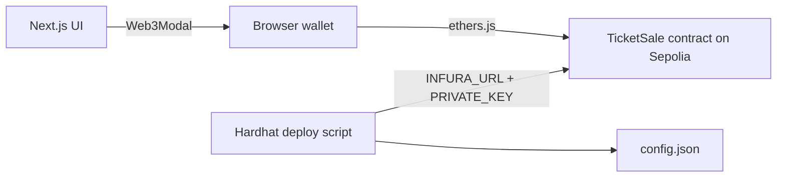
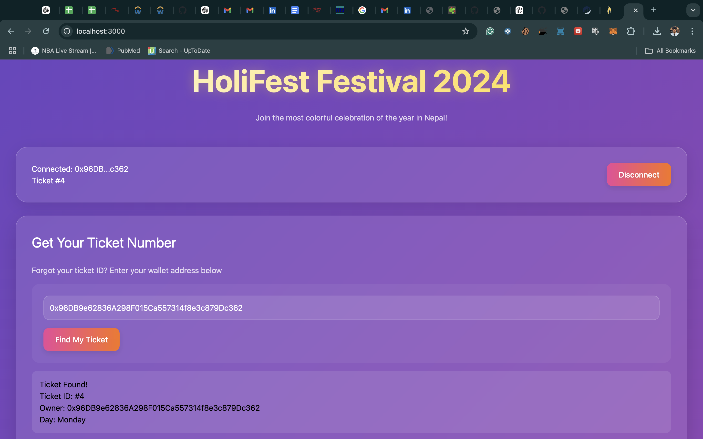
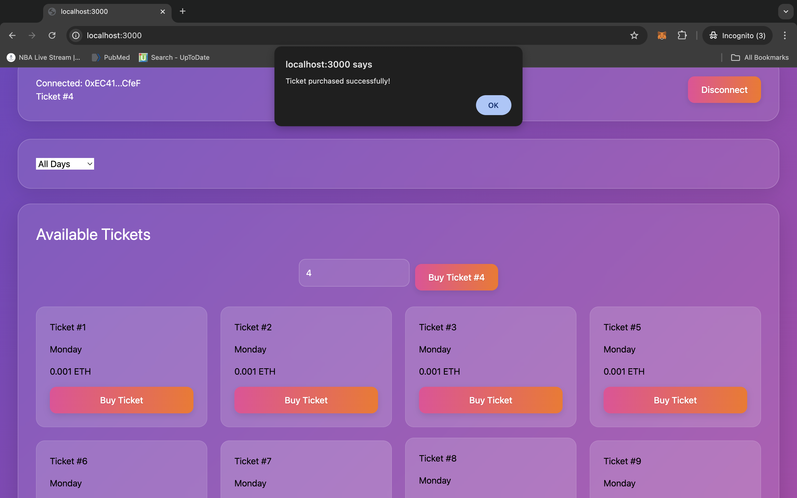
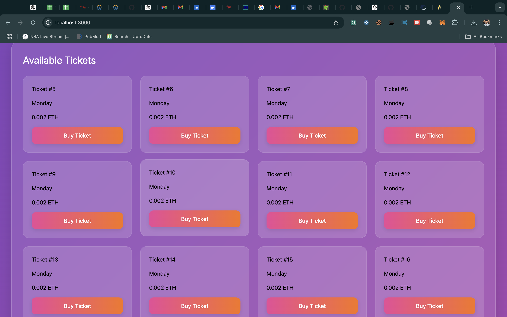
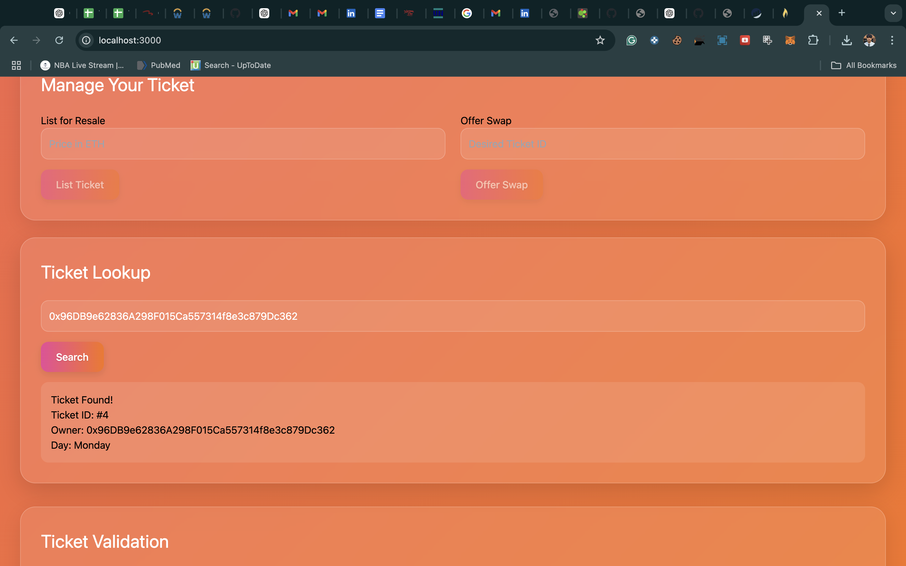
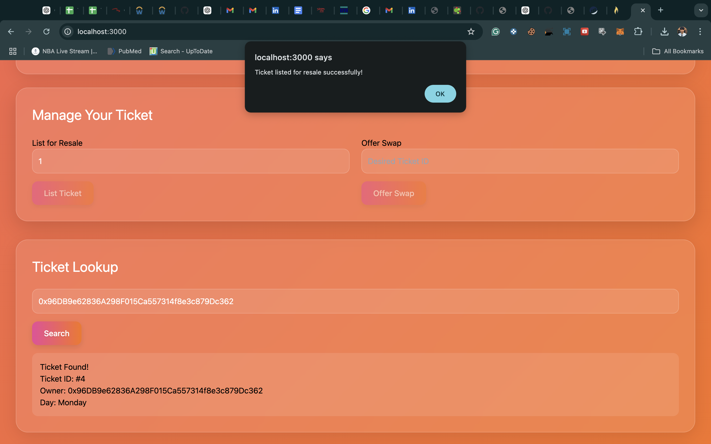
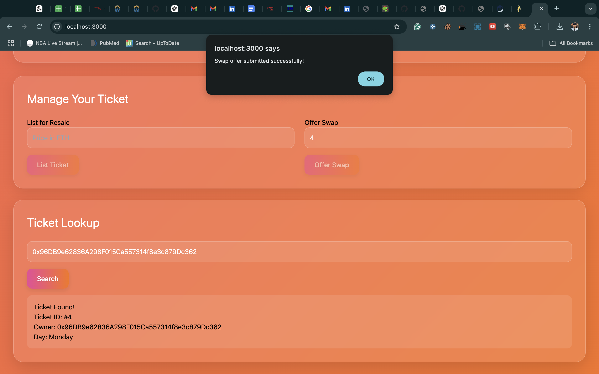
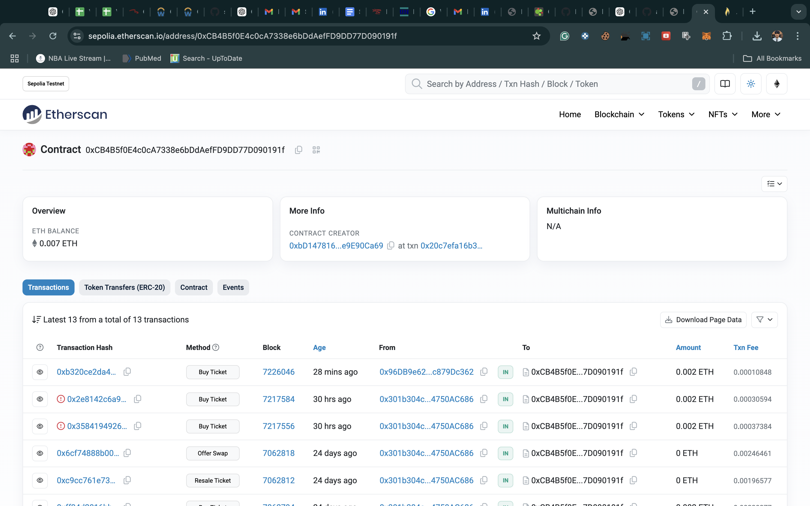

<div align="center">

# DeFiTickets: HoliFest Ticket Sale dApp

**An Ethereum ticketing dApp for a festival: buy, swap and resell tickets on Sepolia through a Solidity contract and a Next.js front end.**


</div>

---

## Overview

DeFiTickets is a decentralized ticket sale for the "HoliFest Festival 2024" event, as titled in the UI. A single `TicketSale` contract records who owns which ticket, takes payment in ETH, lets holders swap tickets with each other, and runs a resale market that sends a 10% service fee to the event manager. The Next.js front end connects a wallet through Web3Modal and calls the contract with ethers.js.

The project was built as a blockchain course assignment. Earlier versions of this README called it a "Tihar" ticket sale, but the code and UI are branded HoliFest.

## Features

- **Primary sale**: buy any unsold ticket ID at the base price. Each address can hold one ticket, and the payment must match the price exactly.
- **Ticket swaps**: offer a swap on another holder's ticket. That holder can accept, and the contract swaps ownership.
- **Resale market**: list your ticket at a price. A buyer pays the listed amount, the seller gets 90% and the manager gets 10%.
- **Lookup and validation**: find the ticket ID for any wallet address, or check whether a ticket ID is owned and listed for resale.
- **Day-wise labels**: the UI maps ticket ID ranges to festival days (Monday to Friday, plus Weekend).
- **Manager controls**: only the deployer can update the ticket price or add tickets. The contract enforces this.
- **Live activity feed**: the UI subscribes to `TicketPurchased`, `TicketSwapped` and `TicketResold` events.
- **Statistics**: counts of total, sold and available tickets.

## Tech stack

| Layer | Technology |
|-------|------------|
| Smart contract | Solidity `^0.8.17` (`contracts/TicketSale.sol`) |
| Tooling | Hardhat, hardhat-toolbox, Chai, dotenv |
| Front end | Next.js 14 (pages router), React 18, CSS Modules |
| Wallet / chain | Web3Modal 1.x, ethers.js v5, Sepolia testnet |

## Architecture



## Contract API

| Function | Access | Description |
|----------|--------|-------------|
| `buyTicket(ticketId)` | payable | Buy an unsold ticket at `ticketPrice` |
| `getTicketOf(address)` | view | Ticket ID owned by an address (0 if none) |
| `offerSwap(ticketId)` / `acceptSwap(ticketId)` | public | Two-step ticket swap |
| `resaleTicket(price)` / `acceptResale(ticketId)` | public / payable | List your ticket, or buy a listed one (10% fee to manager) |
| `checkResale()` / `getAvailableTickets()` | view | IDs listed for resale / unsold IDs |
| `getTicketDetails(ticketId)` | view | Owner, resale flag and resale price |
| `updateTicketPrice(newPrice)` / `addTickets(n)` | manager | Change price / add supply |

## Project structure

```
contracts/TicketSale.sol    # Smart contract
scripts/deploy.js           # Deploys 100 tickets at 0.001 ETH, writes config.json
scripts/compile.js          # Standalone solc compile helper
test/TicketSale.test.js     # Hardhat + Chai tests
pages/index.js              # Entire dApp UI
styles/                     # CSS Modules + globals
ganache-test.js             # Manual script against a local Ganache node (port 7545)
hardhat.config.js
```

## Getting started

**Prerequisites:** Node.js 18+, MetaMask (or another wallet Web3Modal supports), and Sepolia ETH.

```bash
git clone https://github.com/abhiishek340/DeFiTickets.git
cd DeFiTickets
npm install
```

Create a `.env` file for deployment:

| Variable | Description |
|----------|-------------|
| `INFURA_URL` | Sepolia RPC endpoint URL |
| `PRIVATE_KEY` | Private key of the deployer (manager) account. Never commit it. |

```bash
npx hardhat compile
npx hardhat test                                   # run the contract tests
npx hardhat run scripts/deploy.js --network sepolia
npm run dev                                        # http://localhost:3000
```

After deploying, copy the new address from `config.json` into the `contractAddress` constant at the top of `pages/index.js`. The UI does not read `config.json`.

## Screenshots

<table>
  <tr>
    <td align="center"><br/><b>Find my ticket</b></td>
    <td align="center"><br/><b>Purchase</b></td>
  </tr>
  <tr>
    <td align="center"><br/><b>Available tickets</b></td>
    <td align="center"><br/><b>Ticket lookup</b></td>
  </tr>
  <tr>
    <td align="center"><br/><b>Resale listing</b></td>
    <td align="center"><br/><b>Swap</b></td>
  </tr>
  <tr>
    <td align="center" colspan="2"><br/><b>Transaction on Sepolia Etherscan</b></td>
  </tr>
</table>

There is a recorded walkthrough in [`loom-video.mp4`](loom-video.mp4) (about 16 MB).

## Limitations

- The **"Return Your Ticket"** card calls `returnTicket`, which the contract does not implement, so refunds always fail.
- Each address can hold only one ticket. The day ranges (up to ID 100000) are labels in the UI only. The deploy script creates 100 tickets.
- `checkResale`, `getAvailableTickets` and the constructor loop over every ticket, so gas cost grows with supply.
- Resale payouts use `transfer` and there is no reentrancy guard. This is fine for a testnet demo, but the contract has not been audited.
- Build output (`.next/`, `artifacts/`, `cache/`) is committed to the repo.

---

<div align="center">
Built by <a href="https://github.com/abhiishek340">Abhishek Yadav</a>
</div>
